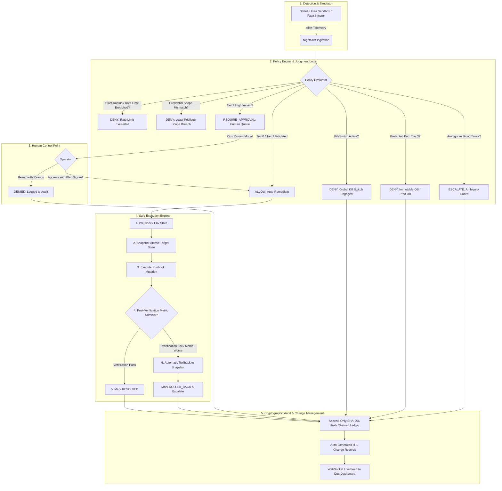

# NightShift
**Problem AO-04: "Automation that is safe enough to leave switched on"**

NightShift turns operations runbooks into policy-governed automated remediations with human control points, hard blast-radius limits, tamper-evident cryptographic audit logs, and verified automatic rollback guarantees.

---

## 1. System Architecture



---

## 2. Core Pillars & Invariants

1. **Strict 4-Tier Safety Policy (`policy.yaml`)**:
   - **Tier 0 (Autonomous Safe)**: Low-impact isolated actions (log rotation, zombie reaping) run without human intervention.
   - **Tier 1 (Autonomous Rate-Limited)**: State-altering actions (worker restarts, consumer scaling) subject to 5 actions/hr/service rate limits.
   - **Tier 2 (Human Approval Mandatory)**: High-impact actions (TLS cert rotation, database connection pool resets, rolling service restarts) require human review, blast-radius verification, and explicit rollback plan sign-off.
   - **Tier 3 (Strictly Protected Surfaces)**: Immutable system paths (`/etc`, `/boot`, `/data/core`) and production primary databases are strictly forbidden from automated mutation.
2. **Ambiguity Escalation (Never Guess)**:
   - When disk utilization is high: if caused by routine logs &rarr; auto-rotate; if caused by crash core dumps or unknown sparse files &rarr; **strictly escalate**. Destructive scripts never guess.
3. **Execution Engine with Automatic Rollback**:
   - Every mutation follows: `Pre-check` &rarr; `State Snapshot` &rarr; `Execute` &rarr; `Post-Verify`. If the post-check fails or conditions deteriorate, the engine atomically rolls back to the snapshot immediately.
4. **Hardware-Style Global Kill-Switch & Per-Service Pause**:
   - Big red toggle switch instantly halts all automated remediations across the entire fleet in under 1 millisecond.
5. **Least-Privilege Scoped Credentials**:
   - Runbooks require explicit scopes (`disk:clean_logs`, `worker:restart`, `cert:rotate`). Any attempt to exceed token permissions is immediately blocked.
6. **Tamper-Evident SHA-256 Audit Chain & ITIL Records**:
   - Every event is linked via a cryptographic hash chain. Any retrospective tampering breaks verification. Each automated action auto-generates a standardized ITIL change ticket.

---

## 3. Quickstart & Setup

### Option A: Local Development (Recommended)

#### Backend (Python FastAPI)
```bash
cd backend
python -m pip install -r requirements.txt
python seed.py        # Initializes SQLite schema and pristine baseline
python -m uvicorn app.main:app --reload --port 8000
```
Backend runs at: `http://localhost:8000` (API Docs: `http://localhost:8000/docs`)

#### Frontend (React + Vite + Tailwind)
```bash
cd frontend
npm install
npm run dev
```
Frontend runs at: `http://localhost:5173`

#### Run Tests
```bash
python tests/run_tests.py
```
All 18 comprehensive tests verify policy tiers, kill switch, automatic rollback, ambiguity escalation, and cryptographic audit hashing.

---

### Option B: Docker Compose (One-Command Startup)
```bash
docker compose up --build
```

---

## 4. 3-Minute Hackathon Demo Script

### Minute 0:00 - 0:45: The Problem & Live Dashboard
1. Open `http://localhost:5173` to view the **NightShift Ops Dashboard**.
2. Point out the top **Global Kill-Switch** (hardware-style red switch), the live WebSocket telemetry stream indicator, and the simulated hosts (`host-01`, `host-02`, `host-03`).
3. Point out the **100% Zero Unsafe Actions** KPI and **100% Audit Integrity** guarantee.

### Minute 0:45 - 1:30: The 1-Click 10-Fault Scenario Runner
1. Click **Fault Injector** tab.
2. Click the prominent **"Run 10-Fault Demo"** button.
3. Watch the real-time WebSocket feed process 10 distinct operational edge cases:
   - **Routine Log Spike**: Auto-remediated (Tier 0).
   - **Ambiguous Core Dumps**: Engine refuses to delete crash dumps &rarr; **ESCALATED** with plain-English explanation.
   - **Protected Surface Tamper (`/etc/sudoers`)**: Instantly **DENIED** (Tier 3).
   - **Stuck Worker**: Auto-restarted and verified healthy (Tier 1).
   - **Failing Worker Fix**: Pre-check &rarr; Snapshot taken &rarr; Execution &rarr; Verification fails &rarr; **Automatic Rollback** restores pre-incident state!
   - **Expiring TLS Certificate**: Queued in the human approvals queue (Tier 2).

### Minute 1:30 - 2:15: Human Control Points & Explainability
1. Click **Approvals** tab &rarr; see the pending Tier 2 TLS Certificate Rotation ticket.
2. Review the proposed steps, blast-radius limit (1 host), and verified rollback plan.
3. Click **"Approve & Execute"** with your operator name and rationale &rarr; observe execution and resolution.
4. Click into any incident to open the **Explainability Modal**:
   - Point out **"Why this was decided"** in plain English.
   - Show the step-by-step visual execution trace from alert to snapshot to verification.
   - Show the state snapshot inspection diff and the manual backout button.

### Minute 2:15 - 3:00: Safety Controls & Cryptographic Audit
1. Engage the big red **Global Kill-Switch** in the top bar with a reason &rarr; banner turns red across the app.
2. Try injecting a fault from the Fault Injector &rarr; instantly **DENIED**: *"HALTED: Global kill-switch is ENGAGED"*.
3. Disengage the Kill-Switch.
4. Click **Audit Ledger** tab:
   - Point to the **Cryptographic Chain Valid (SHA-256)** badge.
   - Click **Verify Chain** &rarr; mathematically validates all blocks.
   - Click **Export JSON** or **Export CSV** to download the audit log.
   - Switch to the **ITIL Standard Change Tickets** tab &rarr; show auto-generated compliance change records.
